# Poly Haven: Interiors HDRIs

**33 assets from [Poly Haven](https://polyhaven.com), dedicated to the public domain under [CC0](https://polyhaven.com/license).** Use them in any game, free or paid, and change them however you like; no credit is needed.

HDRI skies and environments as 1K and 2K Radiance `.hdr` images, for lighting and backgrounds. 266.5 MB in all.

This is a copy kept by [zuujis-cc0](https://github.com/zuujis-cc0) so game makers can take single files from GitHub. It is not made by or affiliated with Poly Haven: the originals, often in more formats and higher resolutions, are on [polyhaven.com](https://polyhaven.com). If they help you, consider [supporting Poly Haven](https://www.patreon.com/polyhaven/overview).

Every file is listed in [MANIFEST.tsv](MANIFEST.tsv) with its size and SHA-256. More free assets: [the Zuujis collection](https://github.com/zuujis-cc0/free-game-assets#readme).

| | | | |
| :-: | :-: | :-: | :-: |
| <a href="small_empty_room_2">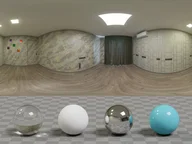</a> <b><a href="small_empty_room_2">Small Empty Room 2</a></b> by Sergej Majboroda · <a href="https://polyhaven.com/a/small_empty_room_2">source</a> | <a href="small_empty_room_3">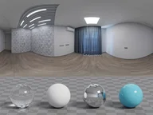</a> <b><a href="small_empty_room_3">Small Empty Room 3</a></b> by Sergej Majboroda · <a href="https://polyhaven.com/a/small_empty_room_3">source</a> | <a href="small_empty_room_4">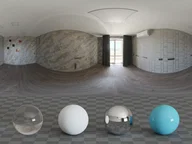</a> <b><a href="small_empty_room_4">Small Empty Room 4</a></b> by Sergej Majboroda · <a href="https://polyhaven.com/a/small_empty_room_4">source</a> | <a href="small_workshop">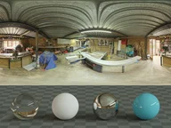</a> <b><a href="small_workshop">Small Workshop</a></b> by Dimitrios Savva, Jarod Guest · <a href="https://polyhaven.com/a/small_workshop">source</a> |
| <a href="solitude_interior">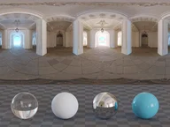</a> <b><a href="solitude_interior">Solitude Interior</a></b> by Andreas Mischok · <a href="https://polyhaven.com/a/solitude_interior">source</a> | <a href="squash_court">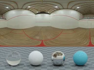</a> <b><a href="squash_court">Squash Court</a></b> by Greg Zaal, Jarod Guest · <a href="https://polyhaven.com/a/squash_court">source</a> | <a href="st_fagans_interior">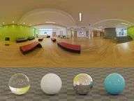</a> <b><a href="st_fagans_interior">St. Fagans Interior</a></b> by Morgan Evans · <a href="https://polyhaven.com/a/st_fagans_interior">source</a> | <a href="storeroom">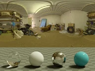</a> <b><a href="storeroom">Storeroom</a></b> by Greg Zaal · <a href="https://polyhaven.com/a/storeroom">source</a> |
| <a href="subway_entrance">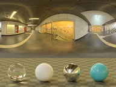</a> <b><a href="subway_entrance">Subway Entrance</a></b> by Greg Zaal · <a href="https://polyhaven.com/a/subway_entrance">source</a> | <a href="sundowner_deck">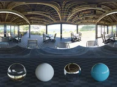</a> <b><a href="sundowner_deck">Sundowner Deck</a></b> by Dario Barresi · <a href="https://polyhaven.com/a/sundowner_deck">source</a> | <a href="surgery">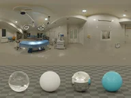</a> <b><a href="surgery">Surgery</a></b> by Oliksiy Yakovlyev · <a href="https://polyhaven.com/a/surgery">source</a> | <a href="thatch_chapel">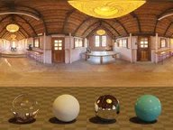</a> <b><a href="thatch_chapel">Thatch Chapel</a></b> by Dimitrios Savva, Jarod Guest · <a href="https://polyhaven.com/a/thatch_chapel">source</a> |
| <a href="theater_01">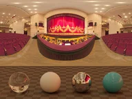</a> <b><a href="theater_01">Theater 01</a></b> by Oliksiy Yakovlyev · <a href="https://polyhaven.com/a/theater_01">source</a> | <a href="theater_02">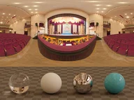</a> <b><a href="theater_02">Theater 02</a></b> by Oliksiy Yakovlyev · <a href="https://polyhaven.com/a/theater_02">source</a> | <a href="trekker_monument">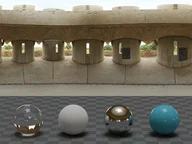</a> <b><a href="trekker_monument">Trekker Monument</a></b> by Dimitrios Savva, Jarod Guest · <a href="https://polyhaven.com/a/trekker_monument">source</a> | <a href="university_workshop">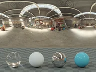</a> <b><a href="university_workshop">University Workshop</a></b> by Savva Zakharov · <a href="https://polyhaven.com/a/university_workshop">source</a> |
| <a href="ushaka_sea_world_aquarium">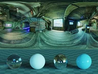</a> <b><a href="ushaka_sea_world_aquarium">Ushaka Sea World Aquarium</a></b> by Dario Barresi, Jarod Guest · <a href="https://polyhaven.com/a/ushaka_sea_world_aquarium">source</a> | <a href="vestibule">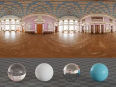</a> <b><a href="vestibule">Vestibule</a></b> by Sergej Majboroda · <a href="https://polyhaven.com/a/vestibule">source</a> | <a href="vintage_measuring_lab">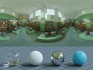</a> <b><a href="vintage_measuring_lab">Vintage Measuring Lab</a></b> by Oliksiy Yakovlyev · <a href="https://polyhaven.com/a/vintage_measuring_lab">source</a> | <a href="voortrekker_interior">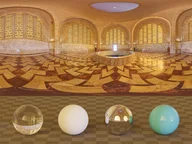</a> <b><a href="voortrekker_interior">Voortrekker Interior</a></b> by Dimitrios Savva, Jarod Guest · <a href="https://polyhaven.com/a/voortrekker_interior">source</a> |
| <a href="vulture_hide">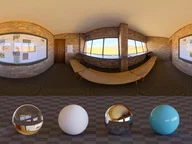</a> <b><a href="vulture_hide">Vulture Hide</a></b> by Greg Zaal · <a href="https://polyhaven.com/a/vulture_hide">source</a> | <a href="warm_bar">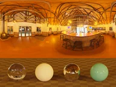</a> <b><a href="warm_bar">Warm Bar</a></b> by Greg Zaal, Jarod Guest · <a href="https://polyhaven.com/a/warm_bar">source</a> | <a href="warm_reception_dinner">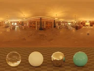</a> <b><a href="warm_reception_dinner">Warm Reception Dinner</a></b> by Dimitrios Savva, Jarod Guest · <a href="https://polyhaven.com/a/warm_reception_dinner">source</a> | <a href="warm_restaurant">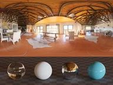</a> <b><a href="warm_restaurant">Warm Restaurant</a></b> by Greg Zaal, Jarod Guest · <a href="https://polyhaven.com/a/warm_restaurant">source</a> |
| <a href="warm_restaurant_night">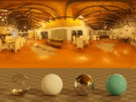</a> <b><a href="warm_restaurant_night">Warm Restaurant Night</a></b> by Greg Zaal, Jarod Guest · <a href="https://polyhaven.com/a/warm_restaurant_night">source</a> | <a href="whale_skeleton">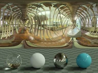</a> <b><a href="whale_skeleton">Whale Skeleton</a></b> by Oliksiy Yakovlyev · <a href="https://polyhaven.com/a/whale_skeleton">source</a> | <a href="white_chapel">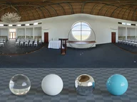</a> <b><a href="white_chapel">White Chapel</a></b> by Jenelle van Heerden · <a href="https://polyhaven.com/a/white_chapel">source</a> | <a href="witsand_woolshop">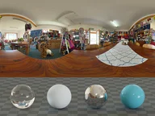</a> <b><a href="witsand_woolshop">Witsand Woolshop</a></b> by Jenelle van Heerden · <a href="https://polyhaven.com/a/witsand_woolshop">source</a> |
| <a href="wooden_lounge">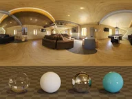</a> <b><a href="wooden_lounge">Wooden Lounge</a></b> by Greg Zaal · <a href="https://polyhaven.com/a/wooden_lounge">source</a> | <a href="workshop">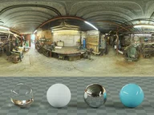</a> <b><a href="workshop">Workshop</a></b> by Dimitrios Savva, Jarod Guest · <a href="https://polyhaven.com/a/workshop">source</a> | <a href="wrestling_gym">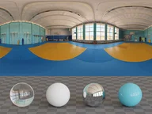</a> <b><a href="wrestling_gym">Wrestling Gym</a></b> by Sergej Majboroda · <a href="https://polyhaven.com/a/wrestling_gym">source</a> | <a href="yaris_interior_garage">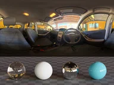</a> <b><a href="yaris_interior_garage">Yaris Interior Garage</a></b> by Greg Zaal · <a href="https://polyhaven.com/a/yaris_interior_garage">source</a> |
| <a href="yoga_room">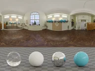</a> <b><a href="yoga_room">Yoga Room</a></b> by Sergej Majboroda · <a href="https://polyhaven.com/a/yoga_room">source</a> |  |  |  |

---

Kept up to date by this repository's own [update workflow](.github/workflows/update.yml), with code and plan from [cc0-mirror](https://github.com/zuujis-cc0/cc0-mirror). Something wrong? [Open an issue there](https://github.com/zuujis-cc0/cc0-mirror/issues/new) or use the [private report form](https://games.zuujis.com/report).
